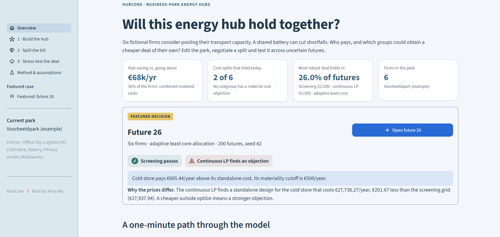
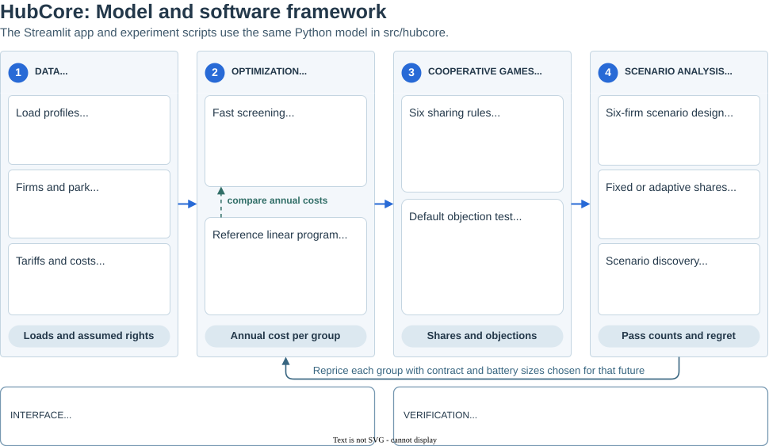
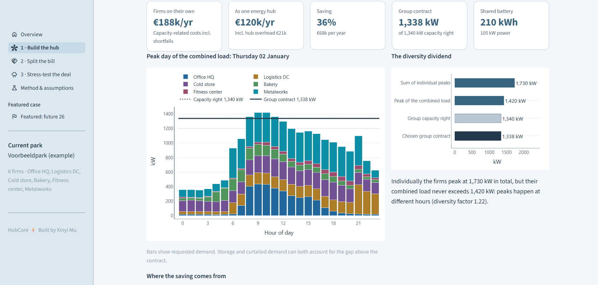
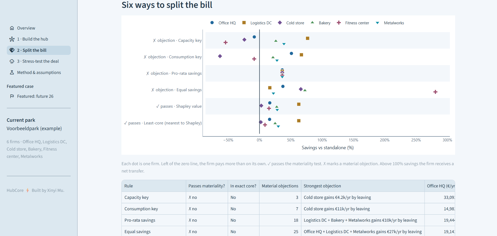
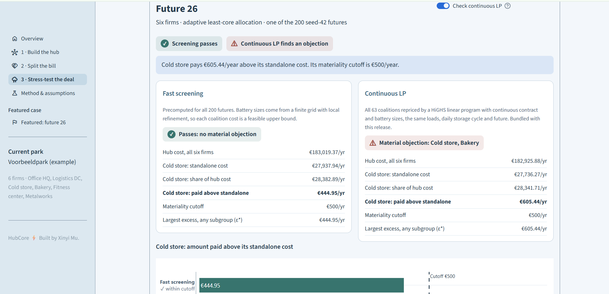

# HubCore: Cost sharing for energy hubs

**When does sharing grid capacity save a business park money, and which firms could pay less by leaving?** HubCore is a Streamlit app for 2-8 firms. It sizes a shared grid contract and battery from hourly demand, compares six ways to split the annual cost and checks what each subgroup would pay on its own.

[Run locally](#run-locally) · [Model, data and sources](docs/MODEL.md)



## What changes a decision?

In a fictional Dutch business park, the six firms save money together in **160 of 200** sampled futures. With the adaptive least-core rule, which minimizes the largest subgroup overpayment, **51 of 200** deals pass under continuous linear programming (LP). The fast screening calculation shown on the Overview screen gives **52 of 200**. The counts describe scenarios with synthetic loads and assumed capacity rights.

Select **Open future 26** on the Overview screen to see one verdict change. An objection counts when a subgroup's overpayment exceeds **both €500/year and 1%** of its alternative cost. In this future the cold store's cutoff is €500. The LP finds a cheaper standalone design for it.

| Cold store, €/year | Fast screening | Continuous LP |
| :--- | ---: | ---: |
| Standalone cost | €27,937.94 | €27,736.27 |
| Share of hub cost | €28,382.89 | €28,341.71 |
| Paid above standalone | €444.95 | €605.44 |
| Group verdict | Pass | Material objection |

## How it works



<details>
<summary>See the Build, Split and Stress-test screens</summary>

**Build the hub** compares hourly demand with the shared contract and battery.



**Split the bill** shows how each firm's savings change across the six rules.



**Stress-test the deal** identifies which subgroup objects in a selected future.



</details>

## Run locally

Use Python 3.12. Open a terminal in the folder containing `streamlit_app.py` and create a virtual environment.

**Windows (Command Prompt)**

```bat
py -3.12 -m venv .venv
.venv\Scripts\activate.bat
```

**macOS or Linux**

```bash
python3.12 -m venv .venv
source .venv/bin/activate
```

Then run the following commands and open <http://localhost:8501>. Both example parks include precomputed results.

```bash
python -m pip install -r requirements.txt
python -m streamlit run streamlit_app.py
```

## Check the results

In the activated environment, install the test dependencies and run the checks.

```bash
python -m pip install -r requirements-dev.txt
python -m pytest -q
python -m ruff check .
```

To rebuild the hourly data and numerical results, follow the [reproduction steps](docs/MODEL.md#reproduce-the-results).

Design by Xinyi Mu · [Software citation](CITATION.cff) · [MIT license](LICENSE)
